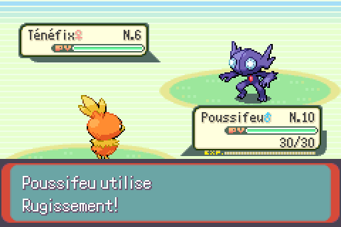
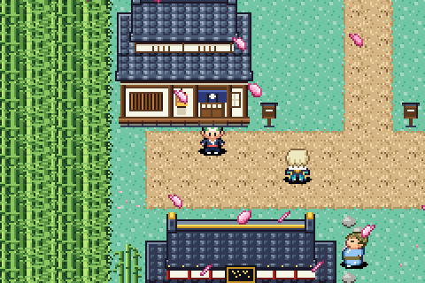

# Test 11 : effets visuels (VFX) — thème sakura

Deux effets créés de zéro, dessinés pixel par pixel puis corrigés en regardant
des captures du jeu à chaque étape.

## 1. Capacité « Tempête Sakura » (combat)

- Un pétale de 16x16 en 4 images (face, profil, tranche, dos) : il tourne sur lui-même.
- 14 pétales partent du lanceur en arc, tournent autour de la cible
  (devant puis derrière elle, effet 3D), puis éclatent vers l'extérieur.
- Fond teinté en rose pendant l'attaque, flash et secousse de la cible à l'impact.
- Pour le test, elle remplace l'animation de Rugissement.

Itérations : pétale en forme de cœur → cristaux → plumes/lames → forme courte,
diagonale et arrondie (version finale). Orientation variée d'un pétale à l'autre,
teinte du fond adoucie.

## 2. Météo « Sakura » (monde réel)

- Nouvelle météo `WEATHER_SAKURA`, à mettre dans le `map.json` d'une carte.
- Des pétales tombent en diagonale (vent), se balancent et tournoient.
- Ils sont accrochés au décor : ils défilent avec la carte quand le joueur marche.

## Fichiers

- `moteur/battle_anim_sakura.c` : mouvement des pétales en combat.
- `moteur/script_animation.s` : déroulé de la capacité (sons, teinte, impact).
- `moteur/field_weather_sakura.c` : la météo.
- `moteur/sakura.png` : le pétale (4 images).
- `outils/dessin_petale.py` : génère le pétale et ses vues.

## Conclusion

Faisable : nouvelles animations de capacités et nouveaux effets sur la carte
(météo, particules). Les petits sprites d'effet (16x16) se dessinent bien,
contrairement aux grands sprites de dresseurs.
