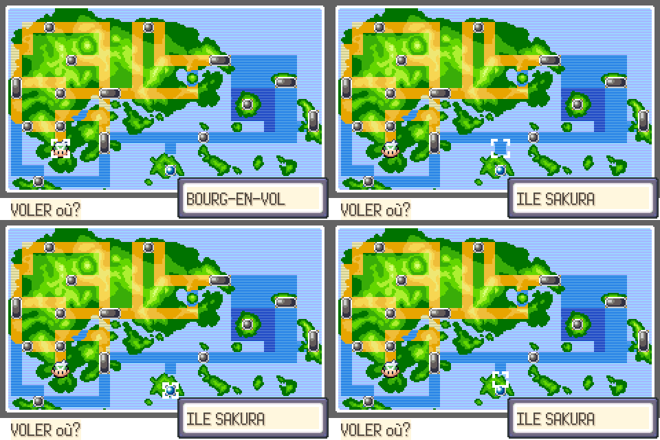
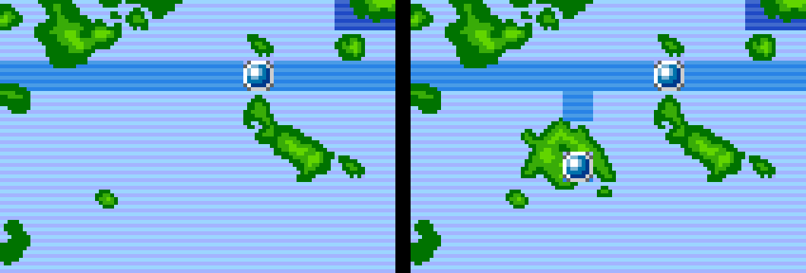

# Test 12 : modifier la carte de région (Carte de Ville / carte de vol)

Test : ajout d'une nouvelle île, « ILE SAKURA », au sud de Hoenn, avec un marqueur de ville,
une voie maritime qui la relie à la route 133, et son nom quand le curseur passe dessus.

## Comment la carte est faite

- `graphics/pokenav/region_map/map.png` : les morceaux de 8x8 pixels (tuiles) de la carte.
- `graphics/pokenav/region_map/map.bin` : la grille 64x64 qui dit quelle tuile va où.
- `src/data/region_map/region_map_sections.json` : les lieux (nom affiché, position).
- `src/data/region_map/region_map_layout.h` : quel lieu correspond à chaque case du curseur (28x15 cases).

## Méthode

1. On reconstitue la carte en une seule image (512x512).
2. On la redessine (ici l'île, avec les couleurs exactes de la carte d'origine).
3. `outils/image_vers_carte.py` redécoupe l'image en tuiles et refait la grille.
4. On ajoute le lieu dans le JSON et dans la grille des cases.

Première version de l'île refusée (ronde, plate, trop claire) ; la seconde est découpée
et texturée comme les autres îles.

## Limites

- 256 tuiles différentes maximum pour toute la carte (Hoenn en utilise 233 ; avec l'île : 244).
  Une carte entièrement redessinée doit réutiliser beaucoup de tuiles (mer, forêt, routes).
- Une seule palette de couleurs pour la carte.
- La carte de répartition du Pokédex est une image à part (`graphics/pokedex/region_map.png`) :
  à mettre à jour aussi si on change la géographie.
- Kanto et les îles Sevii ont leurs propres cartes, modifiables de la même façon.
